# ActOne — System diagrams and workflows

All diagrams are mermaid. Render in GitHub / Cursor preview.  
POMDP belief tracking is not in any diagram on purpose.

---

## 1. System context

The thesis product stops at JSON. The caller is not the thesis.

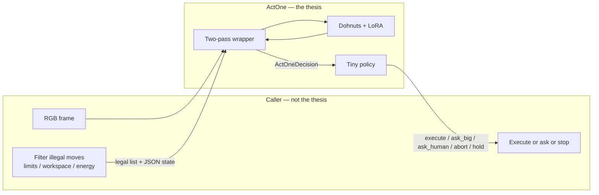

---

## 2. Two-pass inference (production)

This is the frozen inference contract. `hello_predict` is one-pass only as a load test.

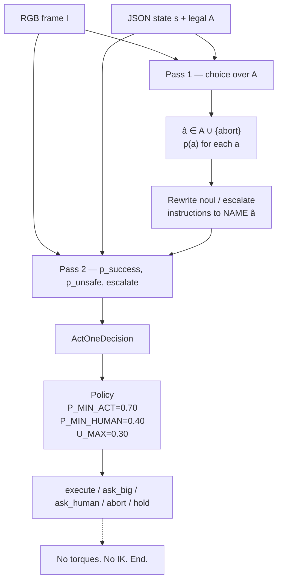

Why two passes: Dohnuts questions in one `predict()` call are independent. A noul head cannot read the action head. So “if the chosen action succeeds” is a lie unless the verb is written into pass 2.

---

## 3. What is inside the net (inherited)

Do not redraw this as a new architecture. You train two blocks only.

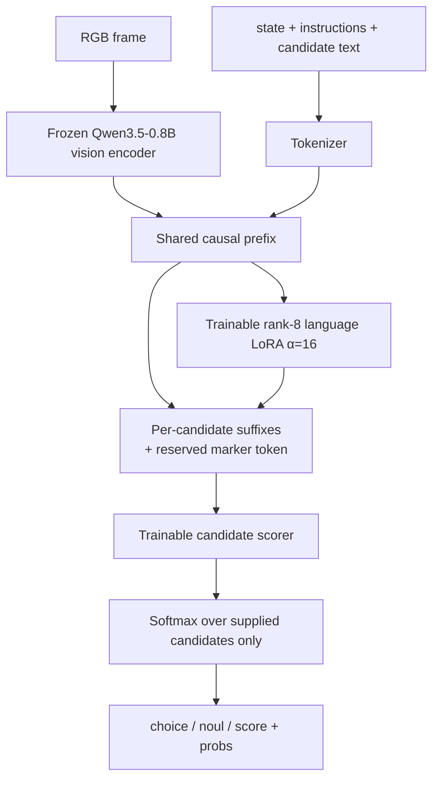

| Block | Status |
|---|---|
| Qwen language backbone | Frozen |
| Vision encoder | Frozen |
| Rank-8 LoRA + scorer | Trainable |
| Packs, two-pass wrapper, temps, eval | Written by this thesis |

---

## 4. Data factory

LIBERO is continuous 7-DoF. ActOne needs discrete skills. This pipeline *is* month-1 work.

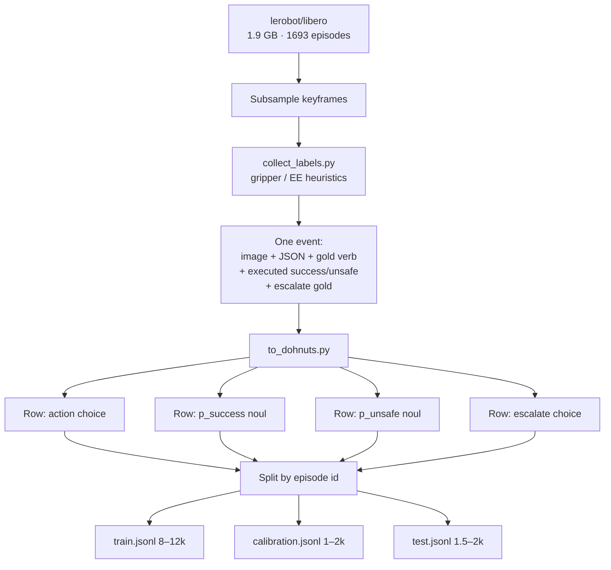

Refuse classes (`ask_big` / `ask_human` / `abort`) ≥ 15% or the escalate head collapses to `act`.

---

## 5. Training workflow

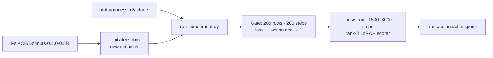

Always a **new** `--output` directory. Do not online-update LoRA during eval.

---

## 6. Calibration then freeze

Test is not used here.

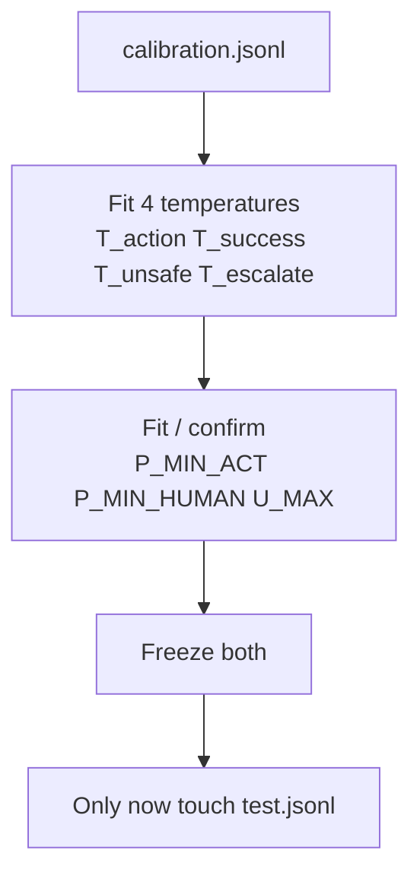

---

## 7. Evaluation pipeline

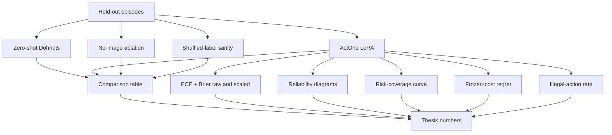

Defence demo = 10 images in, JSON out.

---

## 8. Policy if-chain

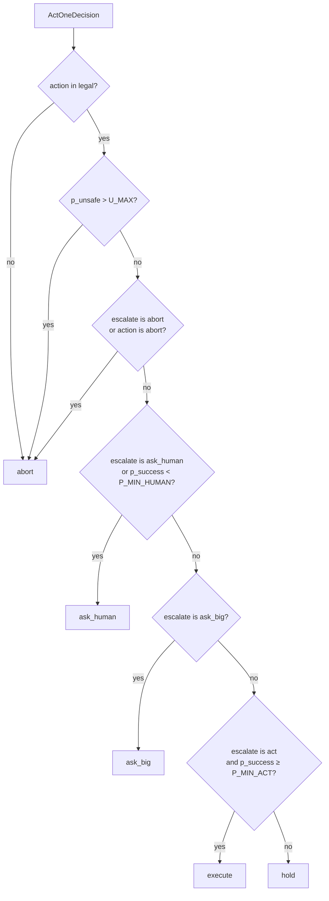

---

## 9. Weekend-to-defence swimlane

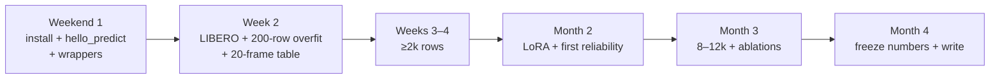

---

## 10. What Cursor may touch

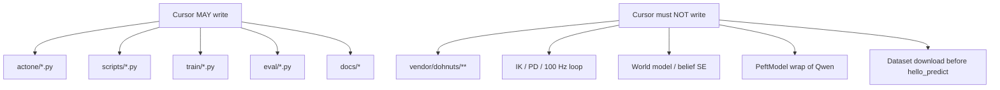

---

## 11. End-to-end sequence (one picture)

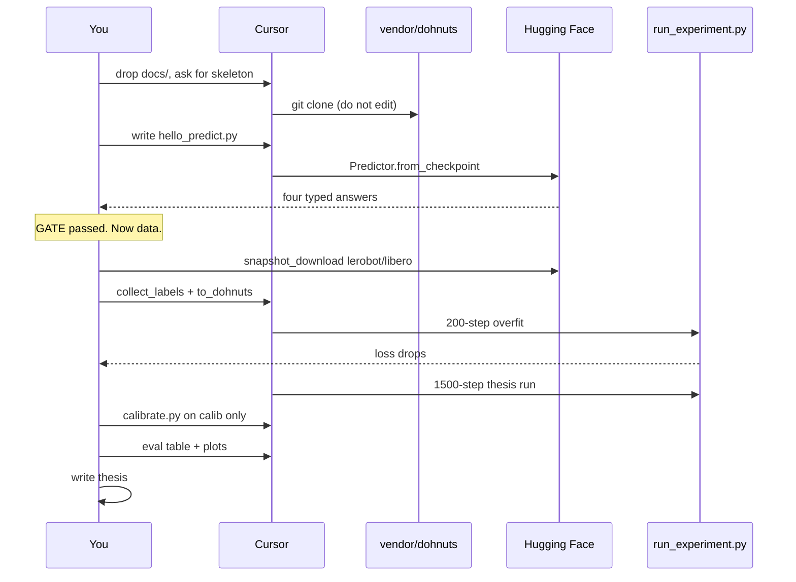
